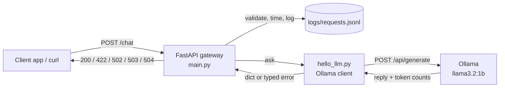

# llm-gateway
 
A small HTTP gateway in front of a local LLM. Apps send a prompt to one stable `/chat` endpoint and get JSON back, without knowing which model or server sits behind it. Every request is logged as structured data (latency, tokens, status) without storing the prompt text.
 
> Learning project, built in public one sprint at a time. Runs fully locally on a laptop with [Ollama](https://ollama.com).
 
## Features
 
- `POST /chat`: send a prompt, get `{reply, model}` back
- `GET /health`: liveness check
- Input validation: empty prompts are rejected with `422`
- Clear upstream error mapping: `502` / `503` / `504` instead of a generic `500`
- Structured JSON-lines request log with a unique `request_id` per request
- Privacy by default: logs record prompt *length*, never prompt *text*
- Configurable timeout through the `LLM_TIMEOUT` environment variable
## Architecture
 

 
| File | Responsibility |
|---|---|
| `main.py` | HTTP API: validation, status-code mapping, request logging |
| `hello_llm.py` | Talks to Ollama; turns network problems into typed exceptions |
 
## Setup
 
Requirements: Linux or macOS, Python 3.14, [uv](https://docs.astral.sh/uv/), [Ollama](https://ollama.com).
 
```bash
git clone https://github.com/rkpsnh/llm-gateway.git
cd llm-gateway
uv sync                      # creates .venv from uv.lock
ollama pull llama3.2:1b      # ~1.3 GB, runs on CPU or GPU
```
 
## Usage
 
```bash
uv run uvicorn main:app --reload
```
 
Interactive API docs: http://localhost:8000/docs
 
```bash
curl -X POST localhost:8000/chat \
  -H "Content-Type: application/json" \
  -d '{"prompt":"Say hi in 5 words"}'
# {"reply":"Hello, it's nice to meet.","model":"llama3.2:1b"}
```
 
### Configuration
 
| Variable | Default | Meaning |
|---|---|---|
| `LLM_TIMEOUT` | `60` | Seconds to wait for Ollama before returning `504` |
 
### Status codes
 
| Code | When | Client message |
|---|---|---|
| `200` | Reply generated | the reply |
| `422` | Empty or missing prompt | validation details |
| `502` | Ollama answered with an error | `LLM backend returned an error` |
| `503` | Ollama can't be reached | `LLM backend unavailable` |
| `504` | Ollama didn't reply within `LLM_TIMEOUT` | `LLM backend timed out` |
 
Clients get generic messages; the full error goes only to the log, so internal hosts and URLs aren't exposed.
 
### Request log
 
One JSON line per request in `logs/requests.jsonl` (gitignored):
 
```json
{"request_id": "4a029c2c-...", "timestamp": "...", "model": "llama3.2:1b", "prompt_chars": 2, "latency_ms": 2218.9, "status_code": 200, "prompt_tokens": 26, "completion_tokens": 8, "error": null}
```
 
- `request_id` is a random UUID4: unique across restarts and multiple servers, with no shared counter
- Token counts are `null` when the model didn't answer (unknown, not zero)
- The log is written in a `finally` block, so failed requests are logged too
## Results
 
<!-- TODO: fill in from your own runs -->
- Typical warm latency for `llama3.2:1b`: [X] ms
- Cold-start time after the Vulkan fix: ~2.7 s (was ~91 s)
- Test set results: see MER-104 (coming next)
## Known issues and incident log
 
**Model loads stalled or failed (Nov 2026)**
- **Symptom:** `/chat` timed out after 60 s; `curl` straight to Ollama hung too, so the problem was upstream, not in the gateway.
- **Evidence:** `journalctl -u ollama` showed the model process hanging during GPU startup; a cold start took ~91 s against ~0.5 s warm.
- **Root cause:** `vk::PhysicalDevice::createDevice: ErrorInitializationFailed`. Ollama's default Vulkan backend failed on a dual-GPU laptop (Intel iGPU + GTX 1060).
- **Fix:** disabled Vulkan with a systemd override (`Environment="OLLAMA_VULKAN=0"`) so Ollama uses CUDA. Cold start dropped from ~91 s to ~2.7 s.
- **Lessons:** check upstream logs before changing code; a client timeout shorter than the model's load time causes a retry loop that never succeeds.
## Roadmap
 
- [x] Local model call with error handling
- [x] FastAPI `/chat` and `/health`
- [x] Structured request logging, 502/503/504 mapping
- [ ] Test set for LLM outputs (MER-104)
- [ ] Hosted providers (Claude, OpenAI, Gemini) behind the same interface
- [ ] Docker and GitHub Actions CI
- [ ] Evals, monitoring and cost tracking
 
Claude finished the response
